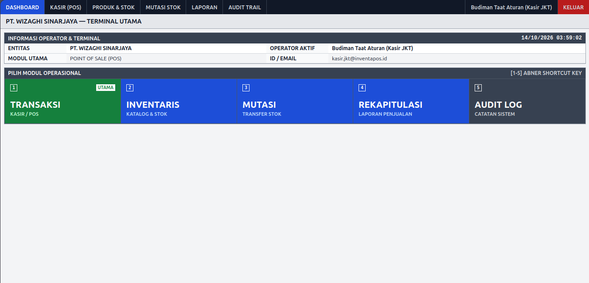
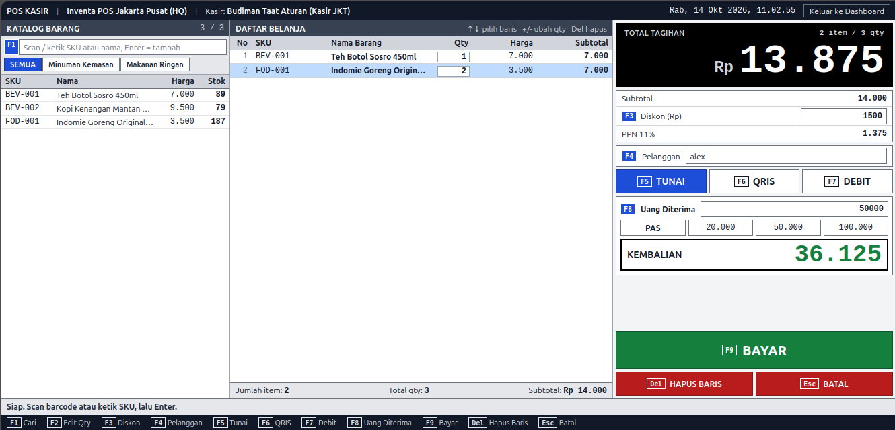
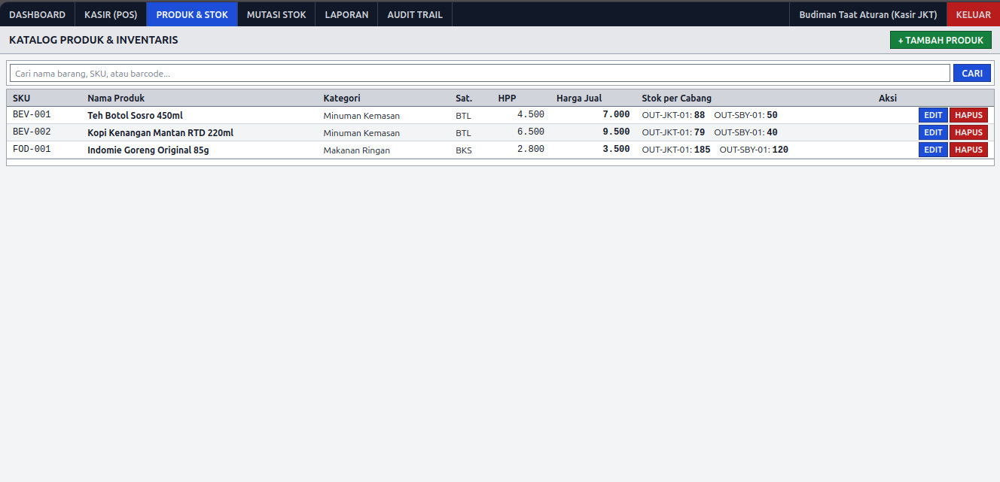
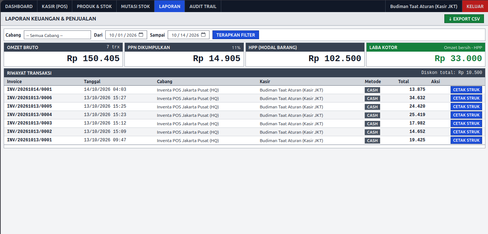

# Inventa POS

Inventa POS is an mini Point of Sale (POS) and multi-branch inventory management system. It handles retail operations, tracks stock distribution across branch locations, and produces automated financial and tax reports.

- **Repository:** `git@github.com:zaidnshr1/inventa-pos.git`
- **License:** MIT License

---

## 1. Overview

Inventa POS provides an integrated solution for multi-branch retail. The application separates operational duties between cashiers and administrators, maintaining strict audit logs, automated stock adjustments upon checkout, and centralized transaction archives.

---

## 2. Tech

The application relies on a modern, robust technology stack following the MVC design pattern:

- **Framework:** Laravel 12 (PHP)
- **Architecture:** Model-View-Controller (MVC)
- **Frontend Engine:** Blade Templates, HTML, CSS
- **Database:** PostgreSQL 16
- **Containerization:** Docker Compose
- **Authentication:** Laravel Breeze
- **CLI & Management Tools:** Artisan, Composer, Laravel Tinker

---

## 3. Feature

- **Point of Sale (POS) Terminal:** High-speed cashier interface supporting barcode/SKU scanning, item quantity adjustments, custom discounts, customer association, and multi-tender payments (Cash, QRIS, Debit).
- **Multi-Branch Inventory Management:** Centralized product catalog with individual stock level tracking per physical store or warehouse branch.
- **Financial & Sales Reporting:** Real-time calculation of gross revenue, Cost of Goods Sold (COGS/HPP), Value Added Tax (VAT/PPN), and net profit with CSV export capabilities.
- **Thermal Receipt Printing:** Standardized structural layout for instant transaction receipt generation.
- **Audit Trail:** Comprehensive system logging to monitor operator actions and track operational history.

---

## 4. Installation

Follow these steps to set up the development environment locally:

1. Clone the repository:
   ```bash
   git clone git@github.com:zaidnshr1/inventa-pos.git
   cd inventa-pos
   ```

2. Install PHP dependencies via Composer:
   ```bash
   composer install
   ```

3. Configure the environment file:
   ```bash
   cp .env.example .env
   ```

4. Start the PostgreSQL database service using Docker Compose:
   ```bash
   docker compose up -d
   ```

5. Generate the application encryption key:
   ```bash
   php artisan key:generate
   ```

6. Run database migrations:
   ```bash
   php artisan migrate
   ```

7. Start the local Laravel development server:
   ```bash
   php artisan serve
   ```

---

## 5. Documentation

### Dashboard Overview


### Cashier Transaction Interface


### Branch Product & Stock Inventory


### Transaction Records & Financial Summary


### Thermal Receipt Output


---

## License

This project is open-source software licensed under the [MIT License](LICENSE).